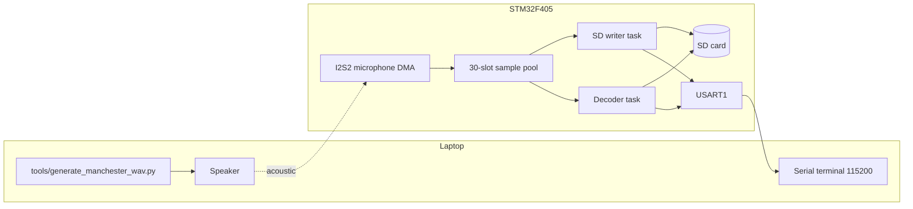

# Architecture



## Runtime

`main` brings up the 168 MHz clock, GPIO, DMA, SDIO, USART1, FatFs, and I2S2, then starts the kernel. Tasks are created in `main`, not in the empty CubeMX stub `Core/Src/freertos.c`.

| Task | Priority | Role |
|---|---|---|
| `ManchDecoder` | High | Envelope, one-shot phase search, sync, payload log |
| `SDAudioWriter` | Normal | Mount, WAV record for 15 s, then stop I2S |
| `ReadMicro` | Normal | Block until the writer says the file is ready, then start DMA |

`printf` is redirected in `_write` to a blocking `HAL_UART_Transmit` on USART1. Logging from a DMA callback would be unsafe; the callbacks only copy and enqueue.

## Software map

```text
ManchesterDecoder.ioc          CubeMX clock, pins, middleware
Core/Src/main.c                application: DMA callbacks, writer, decoder
Core/Inc/log_message.h         queue message (audio buffer pointer + length)
Core/Src/wav_header.c          44-byte canonical PCM header
Core/Src/freertos.c            CubeMX placeholder, no tasks
tools/generate_manchester_wav.py
docs/                          design notes for this port
```

HAL, CMSIS, FreeRTOS, and FatFs are vendored so the CubeIDE project builds without a separate firmware pack download.

## Concurrency rules already in the code

* The SD writer holds `SDMutexHandle` across FatFs calls. The decoder takes the same mutex when it appends a result line.
* `SDMountedSem` is released once, after a successful mount. The decoder blocks on it before opening its files.
* `StartCaptureSem` is released once, after the WAV header is written. The microphone task blocks on it before `HAL_I2S_Receive_DMA`.
* Queue depth is 30 messages of `LogMessage_t`. The message carries a pointer into `AudioSafePool`, not a copy of the samples.

## Build

Open `ManchesterDecoder.ioc` or the project directory in STM32CubeIDE 1.10 or newer with the F4 firmware package V1.27.1. Build the Debug configuration and flash the `STM32F405RGTx`. A full rebuild after cloning is required; `Debug/` is not part of the source tree.

Regenerating from CubeMX is safe only if user sections are preserved. The decoder, the pool, and the task bodies all live inside user sections of `main.c`. The `.ioc` still lists older IMU task names from an earlier project skeleton. Those tasks are not created.
